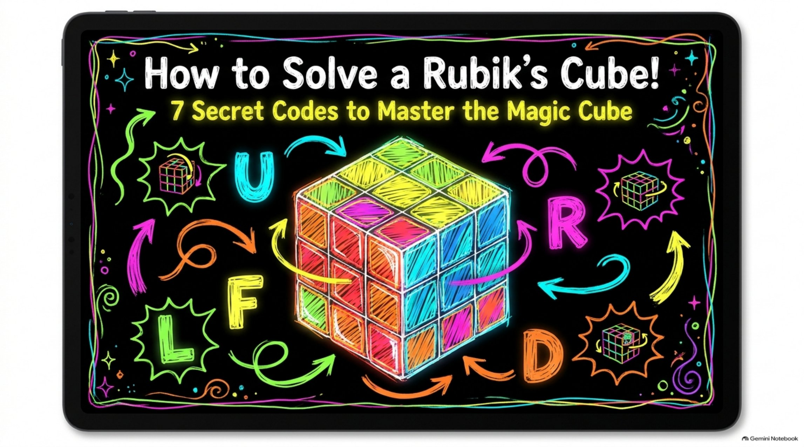

<link rel="stylesheet" href="/assets/rubiks-cube/cube.css">

  <h1>A Rubik’s Cube may be solved systematically layered by layer</h1>
  
Sam Castillo’s beginner method for the 3×3. Seven steps, one algorithm at a time. Watch the tutorial, page through the slides, then drill the moves with the flashcards.

  
A layered solve, not speedcubing — hold the cube as the slides show, and only turn the faces the algorithm names.

  <h2 id="tutorial">Tutorial</h2>
  

  <iframe style="position: absolute; top: 0; left: 0; width: 100%; height: 100%;"
          src="https://rumble.com/embed/v7g3dzi/?pub=4nnnxw"
          title="A Rubik’s Cube may be solved systematically layered by layer"
          frameborder="0"
          allowfullscreen></iframe>

<a href="https://rumble.com/v7i9qx0-a-rubiks-cube-may-be-solved-systematically-layered-by-layer.html?mref=4nnnxw">Watch on Rumble</a>

  <h2 id="slides">Algorithm slides</h2>
  

    

      
    

    

      <button type="button" id="cube-prev-slide">Previous</button>
      
1 / 9 — How to Solve a Rubik’s Cube — seven steps, seven algorithms

      <button type="button" id="cube-next-slide">Next</button>
    

    

    
Download the slides: <a href="/assets/rubiks-cube/downloads/Rubik_s_Cube_Cheat_Codes.pdf">PDF</a> · <a href="/assets/rubiks-cube/downloads/Rubik_s_Cube_Cheat_Codes.pptx">PowerPoint</a>

  

  <h2 id="method">The seven steps</h2>
  <ol class="cube-steps">
    <li>Step 1 · White Cross Build a white plus sign on top, with side colors matching the centers. Most of this is visual. To flip an edge that is in place but upside down: F U' R U.</li>
<li>Step 2 · White Corners Finish the white face and the first-layer ring. Park the corner directly below its target, then repeat R' D' R.</li>
<li>Step 3 · Middle Layer Flip the cube so yellow is on top. Match a non-yellow top edge to its side center, then insert. Right: U R U' R' U' F' U F. Left: U' L' U L U F U' F'.</li>
<li>Step 4 · Yellow Cross Make a yellow plus sign. Start from a dot, a backward L (held top-left), or a horizontal line, and repeat F R U R' U' F'.</li>
<li>Step 5 · Yellow Edges (Sune) Hold two already-matching edges at the back and right, then do R U R' U R U2 R'.</li>
<li>Step 6 · Position Corners (Niklas) Get each yellow corner into the right seat, even if it is twisted. Hold a correct corner in front-right and repeat U R U' L' U R' U' L.</li>
<li>Step 7 · Orient Corners Put an unsolved corner in front-right and repeat R' D' R D until yellow faces up. Then turn <em>only</em> the top layer (U) to bring the next corner over — rotating the whole cube will scramble the layers you already solved.</li>
  </ol>

  <h2 id="flashcards">Flashcards</h2>
  
Thirty-five cards from the tutorial. Click a card to flip it, or use the arrow keys and the space bar.

  

    <button type="button" data-filter="all" aria-pressed="true">All</button>
<button type="button" data-filter="1" aria-pressed="false">Step 1</button>
<button type="button" data-filter="2" aria-pressed="false">Step 2</button>
<button type="button" data-filter="3" aria-pressed="false">Step 3</button>
<button type="button" data-filter="4" aria-pressed="false">Step 4</button>
<button type="button" data-filter="5" aria-pressed="false">Step 5</button>
<button type="button" data-filter="6" aria-pressed="false">Step 6</button>
<button type="button" data-filter="7" aria-pressed="false">Step 7</button>
  

  

    

      <button type="button" class="cube-flip" id="cube-flip" aria-pressed="false" aria-label="Flip flashcard">
        
          
            Question
            
          
          
            Answer
            
          
        
      </button>
    

    

      <button type="button" id="cube-prev-card">Previous</button>
      <button type="button" id="cube-next-card">Next</button>
      <button type="button" id="cube-shuffle">Shuffle</button>
      
    

    
Tip: filter to one step and shuffle it until the algorithm is automatic.

  

  
#rubikscube #speedcubing #rubikscubesolve #satisfying #puzzle #cubing #fyp #viral #brainteaser #math #rubikscubetutorial #howtosolvearubikscube #cubetutorial #3x3 #3x3rubikscube #beginnercubing #learntocube #layerbylayer #layeredmethod #beginnermethod #cubealgorithms #whitecross #yellowcross #sune #twistypuzzle #oddlysatisfying #puzzlesolving #tutorial #educational #STEM #rubixcube #rubixcubetutorial

